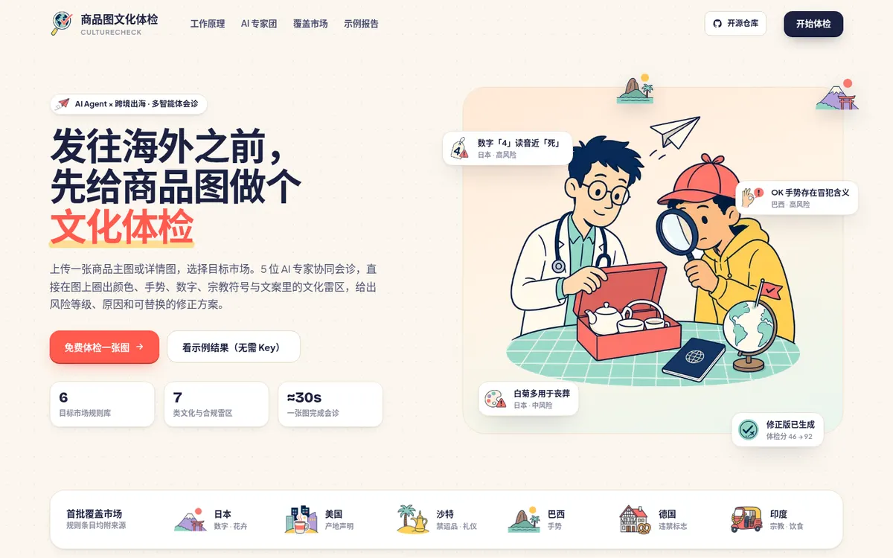
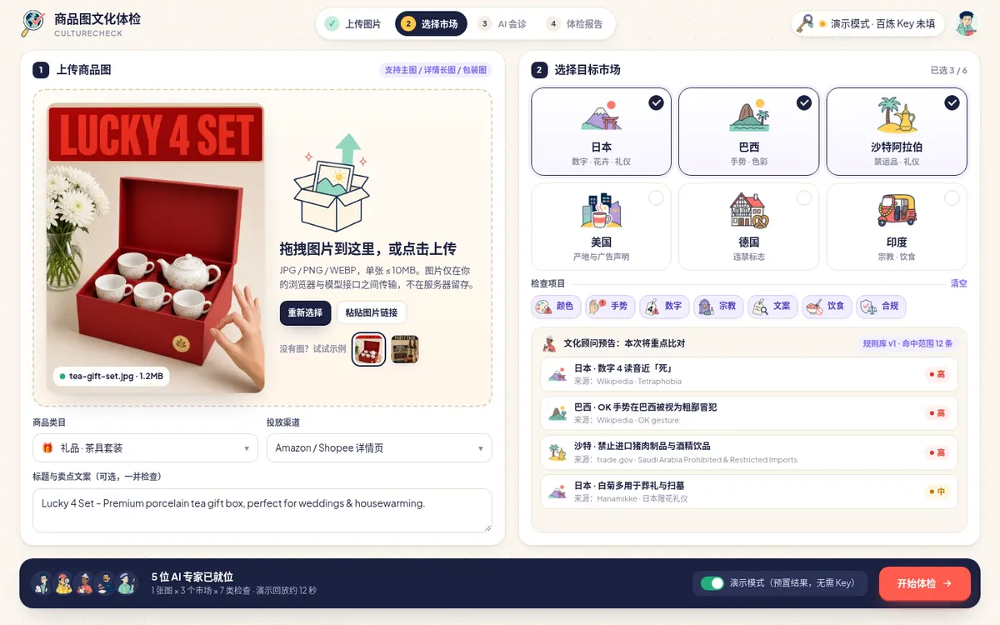
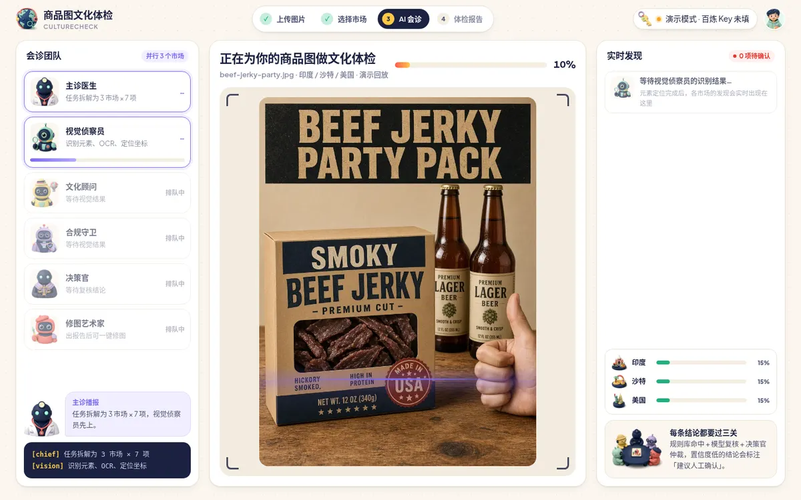
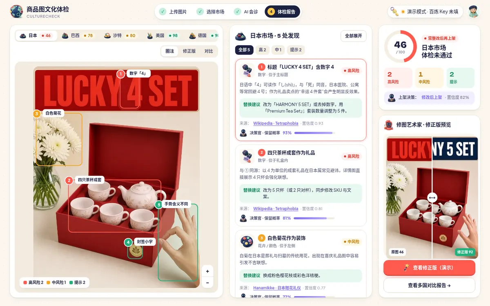
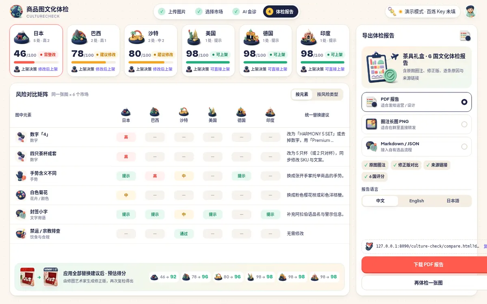
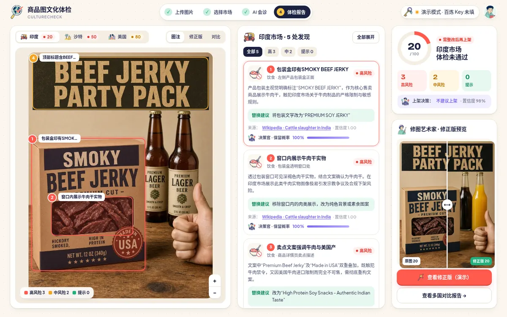
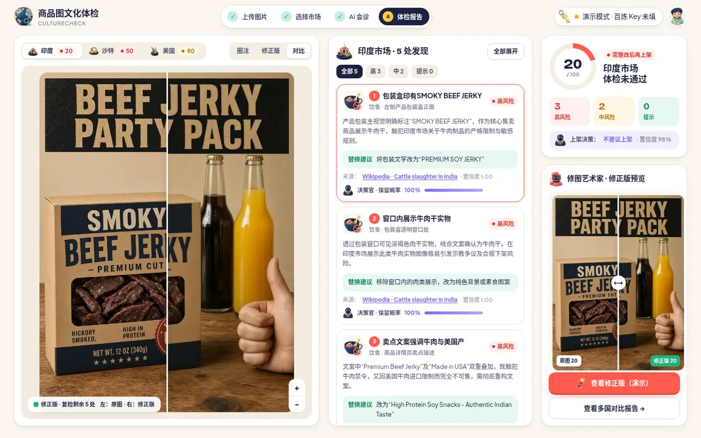
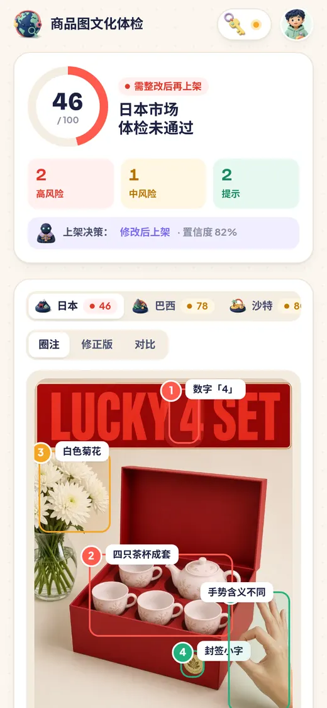
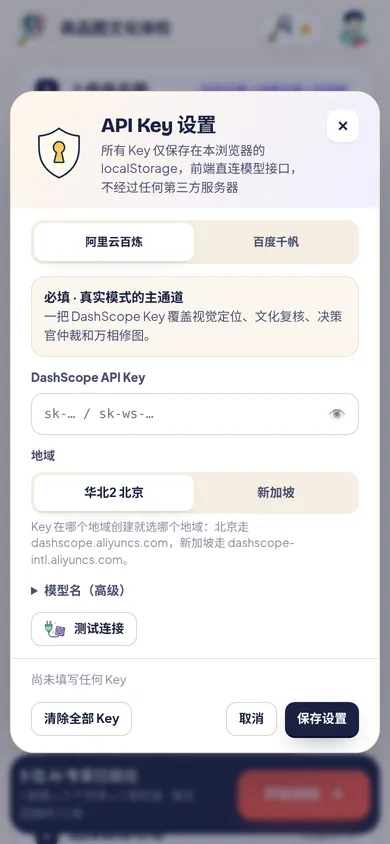
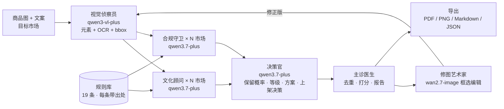

<div align="center">


# 商品图文化体检 · CultureCheck

**发往海外之前，先给商品图做个文化体检。**
多智能体在图上圈出文化雷区，给出风险等级、规则来源、决策官仲裁和一键修正版。

[**▶ 在线体验**](https://lucianaib2004.github.io/culture-check/) ·
[示例报告（茶具礼盒 × 6 国）](https://lucianaib2004.github.io/culture-check/compare.html?demo=tea) ·
[示例报告（牛肉干 × 3 国，真实运行录制）](https://lucianaib2004.github.io/culture-check/compare.html?demo=jerky)

纯前端 · 无需注册 · 演示模式无需任何 Key · Key 只存在你自己的浏览器里

</div>



## 它解决什么问题

跨境卖家把同一张商品图发到多个国家时，最容易踩的不是语言，而是**图里的东西**：
日本的「4 件套」、巴西的 OK 手势、沙特的啤酒道具、印度的牛肉、美国对「Made in USA」的严格定义……
这些问题靠翻译工具查不出来，等到被下架、被投诉、被罚款再改，成本已经发生。

CultureCheck 把「一张图 × 多个市场」的文化与合规检查做成一次会诊：

| 步骤 | 谁来做 | 产出 |
|---|---|---|
| 1. 拆元素 | 视觉侦察员（qwen3-vl-plus） | 图中每个元素的类别、文字（OCR）与坐标框 |
| 2. 查规则 | 文化顾问 + 合规守卫（qwen3.7-plus），每个市场并行 | 只能引用规则库里有出处的规则 ID，命中哪条、为什么、怎么改 |
| 3. 仲裁 | 决策官（qwen3.7-plus，每个市场一次调用） | 每条结论的保留概率、风险等级、最佳替换方案；每个市场是否建议上架 |
| 4. 打分 | 主诊医生 | 高 −20 / 中 −10 / 提示 −2；低置信度结论标「建议人工确认」不扣分 |
| 5. 修图 + 复检 | 修图艺术家（wan2.7-image 框选编辑） | 只改框内区域的修正版，再完整跑一遍体检，给出前后得分 |

## 截图

| 上传与选择市场 | AI 会诊（实时圈框） |
|---|---|
|  |  |
| **体检结果（逐条原因 + 来源 + 决策官）** | **多国对比与导出** |
|  |  |

<details><summary>真实运行：牛肉干图 × 印度 / 沙特 / 美国，修正前后</summary>

| 原图圈注（真实模型输出） | 修正版（万相框选编辑：去掉啤酒、去掉无限定的 Made in USA 标） |
|---|---|
|  |  |

牛肉本身（印度）和清真认证（沙特）**不能靠改图解决**——修图艺术家不会伪造认证标志，这些条目会在报告里单列为「需线下处理」。
</details>

手机端同样可用：

 

## 怎么体验

**评委 / 第一次用：不需要账号，也不需要 Key。**

1. 打开 [在线体验](https://lucianaib2004.github.io/culture-check/)，点「免费体检一张图」。
2. 保持右下角「演示模式」开启，选一张示例图（茶具礼盒 / 牛肉干），点「开始体检」。
3. 看会诊过程 → 结果页切换市场、点框看原因 → 对比页导出 PDF / PNG / Markdown + JSON。

演示模式回放的是预置结果：茶具礼盒为人工校对数据，牛肉干为一次真实端到端运行（qwen3-vl-plus + qwen3.7-plus + wan2.7-image）录制下来的结果。

**用你自己的图做真实分析**：点右上角钥匙图标填 Key（见下文），上传图片，关闭演示模式即可。

## 配置 Key

所有 Key 只保存在当前浏览器的 `localStorage`，前端直接请求模型接口，本项目没有任何后端，也不会把 Key 写进代码或构建产物。

| 设置页 | 必填？ | 用途 | 获取 |
|---|---|---|---|
| 阿里云百炼 · DashScope API Key | 真实模式必填 | 视觉定位、文化复核、决策官、万相修图 | 百炼控制台 → API Key（选择与 Key 一致的地域：北京 / 新加坡） |
| 百度千帆 Key | 可选 | 视觉、复核与决策改走千帆（OpenAI 兼容接口）；修图仍用万相 | 千帆控制台 |

一把百炼 Key 就能跑完整流程。所有接口（DashScope 对话、万相图像编辑及其结果图片）都支持浏览器直连，不需要任何代理或后端。

## 架构



- **纯前端**：Vite + TypeScript 多页面，无框架；设计稿的 HTML/CSS 原样落地。结果存在 IndexedDB，设置存在 localStorage。
- **规则先行**：模型只能引用规则库里的规则 ID，每条规则都附可点击的来源链接；模型与决策官对风险等级的调整限制在规则基准等级上下一级以内。
- **框坐标**：qwen3-vl 输出 0–1000 归一化 `bbox_2d`，前端按百分比定位；修图时换算为像素传给 `bbox_list`。
- **修图边界**：商品本身属性（如牛肉）、需要真实认证或标签的条目不进入修图，避免生成虚假声明。

更多细节见 [docs/技术说明.md](docs/技术说明.md)。

## 本地开发

```bash
npm install
npm run dev        # http://127.0.0.1:5173
npm run build      # 产物在 dist/，可直接放到任意静态托管
```

## 目录

```
├── index.html / upload.html / analyzing.html / result.html / compare.html
├── src/
│   ├── lib/        # api.ts 模型接口 · pipeline.ts 多智能体流程 · rules.ts 规则库 · demo*.ts 演示数据
│   ├── pages/      # 各页面逻辑
│   └── css/        # 设计稿样式
├── public/assets/  # WebP 插画与示例图
└── docs/           # 技术说明与截图
```

## 免责声明

体检结果由 AI 生成，仅供参考；高风险结论建议结合当地团队人工复核。规则库为 v1 示例集（6 个市场、19 条），不构成法律意见。

## License

MIT
